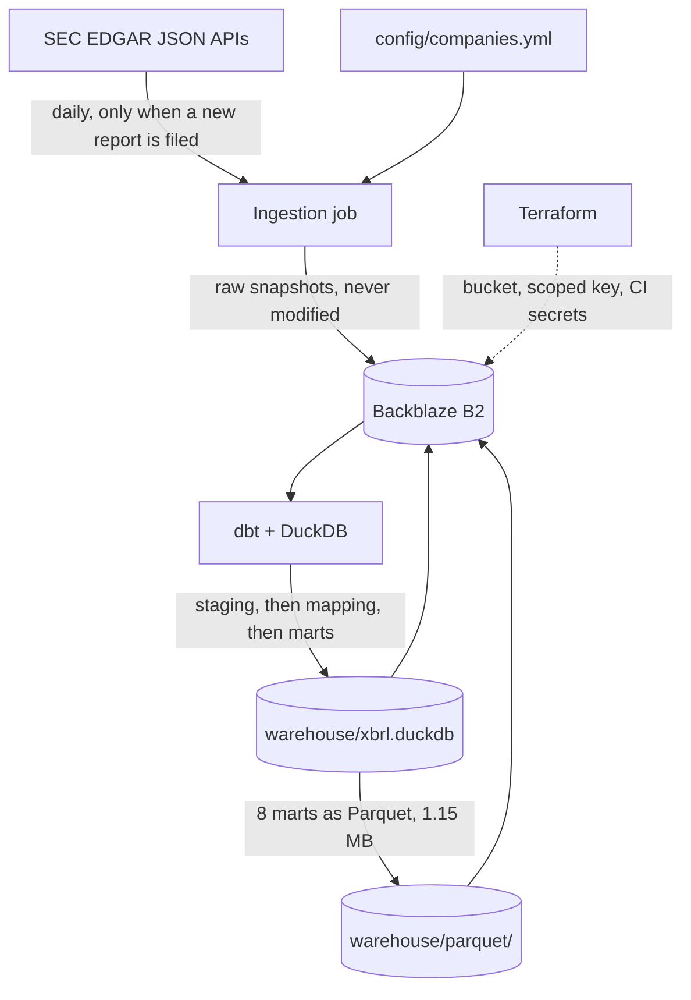

# xbrl-reconcile

[](https://github.com/sushantpatil2899/xbrl-reconcile/actions/workflows/ci.yml)

A data pipeline that ingests SEC XBRL filings for software companies and
reconciles inconsistent accounting tags into comparable financial statements,
with a confidence level on every mapped value.

## The problem

Since 2009, US public companies must tag every number in their financial
reports using XBRL, a machine readable vocabulary. In theory that makes company
comparison trivial. In practice the same concept is tagged differently by
different companies, and by the same company across years.

Measured across the 28 companies in this project:

- **2,047** distinct `us-gaap` concepts are in use. Only **42** are used by all
  28 companies, while **774** are used by exactly one.
- Revenue alone appears under at least five standard tags. Most companies use
  `RevenueFromContractWithCustomerExcludingAssessedTax`; CrowdStrike uses the
  **Including** variant. Intuit has used four different revenue tags over time.
- Companies restate. Salesforce reported total assets at 2018-01-31 as
  **$21,009,802,000** in its annual report, then **$21,984,000,000** three
  months later after an accounting rule change. Both numbers are correct in
  their moment.
- **113,249** of **226,028** company facts are reported by more than one
  filing, so any naive query returns duplicates.
- **A third of the facts are invisible in SEC's JSON API.** Workday never tags a
  total cost of revenue; it reports the figure split by product line, and that API
  drops every dimensional fact. Recovering them needs SEC's quarterly Financial
  Statement Data Sets, where 131,908 of 395,773 facts carry a dimension.

- **The same standard tag can mean different things to different filers.** Workday
  labels `us-gaap:OperatingExpenses` "Total costs and expenses" on its own income
  statement; every other company here labels it "Total operating expenses". Workday's
  figure therefore includes cost of revenue and the others' do not, so reading that
  tag the same way for all of them overstated Workday's operating expenses by exactly
  its cost of revenue, in 92 published values across 13 years.
- **Not every filing that carries XBRL is a financial report.** Proxy statements
  tag net income in their pay versus performance table, often in millions and
  sometimes against the wrong year. A proxy is filed after the 10-K, so a naive
  "latest wins" rule publishes Elastic's 2025 net loss as $0.4 million instead of
  $108.1 million.

A query for "revenue" that assumes one tag silently returns nothing for
CrowdStrike, and silently returns the wrong year's version for Salesforce.
Resolving that is what this project does.

## Status

| Phase | State | What it does |
|---|---|---|
| 0. Foundation | Built | Python project, tests, lint, CI |
| 1. Ingestion | Built | Daily pull of SEC companyfacts and submissions into object storage |
| 2. Staging | Built | Flattens nested JSON into one row per fact, tested and published |
| 3. Mapping | Built | Maps raw tags to canonical concepts with confidence levels |
| 4. Data Sets | Built | Dimensional facts and custom tags from SEC's quarterly Data Sets |
| 5. Marts | Built | Comparable income statement, balance sheet, cash flow, confidence report |
| 6. Linkbase | Built | Checks every mapping against the filings' own declared arithmetic |
| 7. API | Built | FastAPI over the Parquet marts, documented from config |

Running today: four scheduled workflows, 422 dbt nodes and 264 Python tests,
408,213 facts from the JSON API plus 395,773 from the quarterly Data Sets, 16
canonical concepts with a confidence level on every value, and **25,400 published
figures** across 4,900 financial statements, served over HTTP at zero
infrastructure cost.

Every mapping is also checked against the filings' own declared arithmetic, from
**45,647 calculation relationships** parsed out of 259 annual reports. That is what
separates "a standard tag used consistently across the sector" from "the company's
own statement says so": 463 values labelled only *medium* are confirmed by the
filer's arithmetic, and 15,709 labelled *high* have no arithmetic behind them at
all.

The marts are published as Parquet: **1.4 MB for all twelve**, against a 92 MB
database, so reading an income statement costs 101 KB and needs no warehouse.

```sql
select ticker, fiscal_year, revenue, gross_profit, gross_profit_confidence
from 'mart_income_statement.parquet'
where period_kind = 'annual' and calendar_year_equivalent = 2025
order by revenue desc
```

| ticker | fiscal_year | revenue | gross_profit | gross_profit_confidence |
|---|---|---|---|---|
| CRM | 2026 | 41,525 | 32,255 | high |
| ADBE | 2025 | 23,769 | 21,218 | high |
| INTU | 2025 | 18,831 | 15,139 | **derived** |
| NOW | 2025 | 13,278 | 10,295 | high |
| WDAY | 2026 | 9,552 | 7,231 | **derived** |

Four different fiscal year labels, one comparable year. Intuit and Workday never
tag gross profit at all, so theirs is computed from revenue and cost of revenue and
says so.

## Architecture



Both jobs run in GitHub Actions. Transform starts automatically when ingestion
finishes. The runner is wiped after each run, so the database is fetched from
storage, rebuilt, and published back.

A day with no new filings costs **one 15 MB download**: the staging models record
which Data Set quarter and which filing they have already read, so the raw layer is
not read again, and the database is stored gzipped. Before that work a run read 535
files and 92 MB.

## Design decisions

Full reasoning is in [docs/design.md](docs/design.md). The ones that shape
everything else:

- **Config drives the pipeline.** Adding a company is three lines of YAML. No
  ticker, CIK or tag name appears in code.
- **Raw data is never modified.** Snapshots are written once with a UTC
  timestamp and never overwritten, so an earlier view of the data is always
  recoverable.
- **Staging keeps every version of every fact.** Restatements are data, not
  noise, and deduplicating early would throw away the evidence.
- **Only new snapshots are processed.** The staging table's own `source_file`
  column records what has been handled, so a quiet day reads nothing.
- **Failures are separated by cause.** A broken transformation stops the
  pipeline; one company's odd data is quarantined and the other 27 publish.
- **Staleness is measured on a heartbeat**, not on data age, because companies
  file about four times a year and a quiet fortnight is normal.
- **A computed value is never dressed up as a reported one.** Totals recovered by
  summing a company's own components carry their own confidence level, and the
  identity used is recorded alongside the number.
- **Two year labels, because a fiscal year is not a calendar year.** Sixteen of
  these companies end their year in January, so one label spans 335 days. Every
  period carries what the company calls the year and the calendar year it lines up
  with, and no period is ever relabelled onto a quarter it did not report.
- **A statement is published twice over.** Each line carries its latest figure and
  the figure from one filing that reported the whole statement, because a company
  can restate one line of an old balance sheet and never re-publish the rest.
- **Statement layouts come from config.** The order concepts appear in
  `config/tag_mappings.yml` is the order they appear on the statement, and the
  columns are generated from it, so reordering a statement is a config edit.
- **Evidence sits beside confidence rather than replacing it.** Confidence is a
  declared judgement about a mapping; evidence is what the filing's own arithmetic
  says. They disagree often enough to be worth separating, and a parser silently
  rewriting what a published number claims about itself would defeat the point.
- **Evidence is judged per filing, never per company.** A tag can be a total in one
  year and a component in the next for the same filer. Asking whether a company ever
  declared a relationship flags 115 values; asking whether the filing that reported
  the number declares it flags 24.

## Running it

### Locally, without any credentials

```bash
uv sync
uv run pytest
```

To build the models against a local copy of the raw layer:

```bash
cd transform
RAW_ROOT=/path/to/raw uv run dbt build --profiles-dir . --target dev
```

### The API

Needs nothing but the published Parquet, about 1.4 MB. Fetch it once, then run:

```bash
MARTS_PATH=./marts uv run xbrl-fetch-marts
MARTS_PATH=./marts uv run uvicorn xbrl_reconcile.api.asgi:app --port 8000
```

Interactive documentation at `/docs`, the same thing laid out for reading at
`/redoc`. Every parameter's allowed values and their meanings are generated from
`config/vocabularies.yml`, so adding a company or a concept to config changes the
documentation with no code change.

Or in a container, with the data baked in so it needs no credentials to run:

```bash
docker build \
  --secret id=b2_key_id,env=B2_INGEST_KEY_ID \
  --secret id=b2_key,env=B2_INGEST_KEY \
  -t xbrl-reconcile .
docker run -p 8000:8000 xbrl-reconcile
```

Behind a load balancer, set `FORWARDED_ALLOW_IPS` to the proxy's address. uvicorn
trusts `X-Forwarded-For` by default but only from `127.0.0.1`, so left unset every
caller looks like the proxy and the rate limiter puts them all in one bucket. Do not
set it to `*` unless nothing but that proxy can reach the port, because `*` trusts
the header from whoever sent it.

#### What a value looks like

```bash
curl 'localhost:8000/financials?tickers=WDAY&concepts=cost_of_revenue&from_year=2014&to_year=2014'
```

```json
{
  "ticker": "WDAY",
  "concept": "cost_of_revenue",
  "value": 264803000.0,
  "unit": "USD",
  "period_end": "2015-01-31",
  "fiscal_year": 2015,
  "calendar_year_equivalent": 2014,
  "confidence": "medium",
  "source_tag": "fsds:custom:CostOfRevenueSubscriptionAndSupport+us-gaap:TechnologyServicesCosts",
  "evidence": "not_applicable",
  "basis": "us_gaap",
  "form": "10-K"
}
```

Workday never reported a cost of revenue total for that year, only two components.
`confidence: medium` says it was assembled and `source_tag` names both parts. Note
also that `from_year=2014` found fiscal 2015: Workday's year ran February 2014 to
January 2015, and a year range compares calendar years by default.

#### A quarter no company files

```bash
curl 'localhost:8000/financials?tickers=CRM&concepts=revenue&period=quarter&from_year=2025&to_year=2025'
```

```
Q1   9,829,000,000  high     us-gaap:RevenueFromContractWithCustomerExcludingAssessedTax
Q2  10,236,000,000  high     us-gaap:RevenueFromContractWithCustomerExcludingAssessedTax
Q3  10,259,000,000  high     us-gaap:RevenueFromContractWithCustomerExcludingAssessedTax
Q4  11,201,000,000  derived  derived:annual-nine_month
```

They sum to 41,525,000,000, which is the annual figure. The fourth is derived
because the annual report covers the whole year instead of filing a fourth quarter,
and it never pretends to be reported.

#### Where the gaps are

```bash
curl 'localhost:8000/coverage?status=missing'
```

```
total_rows 3
INTU fy2026 cost_of_revenue      missing
INTU fy2026 gross_profit         missing
INTU fy2026 operating_expenses   missing
```

Three cells out of 5,056, all waiting on the SEC publishing a quarter. An API that
can state its own gaps in three rows is a stronger claim than one that cannot answer
the question. `/confidence?trust=check` is the companion: 147 of 4,900 statements
where an identity fails or a line was ambiguous.

#### A typo is an error, not an empty answer

```bash
curl 'localhost:8000/financials?tickers=GOOGL'   # 400
```

```json
{
  "error": "unknown ticker: 'GOOGL'",
  "field": "ticker",
  "value": "GOOGL",
  "valid": ["ADBE", "ADSK", "BOX", "CRM", "CRWD", "..."]
}
```

An empty result would be indistinguishable from a company that filed nothing.

#### When not to use the API

For the whole dataset rather than an answer, read the Parquet directly. DuckDB
fetches only the byte ranges it needs, so this costs a few kilobytes of a 700 KB
file and no server at all:

```sql
select ticker, fiscal_year, value, confidence
from 'https://.../mart_financials.parquet'
where concept = 'revenue' and period_kind = 'annual';
```

### The query page

A single HTML file that loads the Parquet with DuckDB compiled to WebAssembly and
runs the queries **in the reader's browser**. No server, no account, no cold start.

```bash
MARTS_PATH=docs/site uv run xbrl-fetch-marts
cd docs/site && python3 -m http.server 8000
```

It shows four things: all 28 companies lined up on one calendar year with the
confidence on every figure, one company's values with the XBRL tag behind each,
what to distrust, and a query box.

Freshness is handled by treating `_index.json` as the version marker. It is fetched
with `no-store`, and each Parquet is requested as `?v=<published_at>`, so a new
publish is a new cache key while an unchanged one is served from cache. The page
prints the publish time, so staleness is visible rather than silent.

`.github/workflows/pages.yml` deploys the page and the current marts together, and
then asserts the live `_index.json` matches the bucket. It is inert until the
repository variable `PAGES_ENABLED` is set to `true`, which needs the repository
public or a plan allowing Pages from a private one.

### The full pipeline

Needs a Backblaze B2 account (free tier), an HCP Terraform account for state,
and a GitHub token. Terraform creates the bucket, a key scoped to it that
cannot delete files, and the repository secrets the workflows use:

```bash
cd infra/terraform
terraform init && terraform plan
```

Backblaze has two APIs and they do not take the same credentials. The Terraform
provider uses the B2 native API, whose master key ID is 12 characters. Everything
else here, this project's own code and DuckDB's httpfs, speaks the S3 compatible
API, which **rejects the master application key outright**: it needs a key created
under Account, Application Keys, whose ID is around 25 characters. A master key
produces `InvalidAccessKeyId: Malformed Access Key Id`, before any permission is
checked. Terraform creates a scoped key for exactly this reason.

To read the published database locally, create a read only key limited to the
bucket, then:

```bash
export STORAGE_BACKEND=b2 B2_BUCKET=<bucket> B2_ENDPOINT=https://s3.<region>.backblazeb2.com
export B2_INGEST_KEY_ID=<key id> B2_INGEST_KEY=<key>
WAREHOUSE_PATH=transform/prod.duckdb uv run xbrl-fetch-warehouse
```

Ingestion can also be run directly:

```bash
SEC_CONTACT_EMAIL=you@example.com uv run xbrl-ingest      # SEC requires a contact
SEC_CONTACT_EMAIL=you@example.com uv run xbrl-check-ciks  # verify config CIKs
```

## Layout

```
config/companies.yml        the 28 companies, date range, which forms count
src/xbrl_reconcile/
  config.py                 load and validate config
  mappings.py               load and validate the tag mapping config
  ingest/                   polite HTTP client, SEC endpoints, linkbases, storage, run loop
  warehouse.py              fetch and publish the built database
  publish_marts.py          export the marts as Parquet
transform/
  models/staging/           one row per fact, typed, quarantining bad rows
  models/intermediate/      mapping, resolution, the period spine, derived values
  models/marts/             the published facts, three statements, two reports
  macros/                   snapshot selection, statement columns built from config
  tests/                    freshness, accounting identities, mart round trips
infra/terraform/            bucket, scoped key, Actions secrets and variables
.github/workflows/          ci, ingest, ingest-datasets, ingest-linkbase, transform
docs/design.md              decisions and the reasoning behind them
```

## Data source

SEC's free [data.sec.gov](https://data.sec.gov) APIs. Requests identify
themselves with a contact email and stay within SEC's rate limits, as its
access policy requires.

## Author

Sushant Patil, [sushantpatil.me](https://www.sushantpatil.me)
