# xbrl-reconcile

[](https://github.com/sushantpatil2899/xbrl-reconcile/actions/workflows/ci.yml)

Comparable financial statements for 28 software companies, built from SEC XBRL
filings, with a confidence level and a piece of evidence attached to every
single number.

**[Query it in your browser](https://sushantpatil2899.github.io/xbrl-reconcile/)**
· **[API](https://ca-xbrl-reconcile-api.wonderfulwater-66905cf2.northcentralus.azurecontainerapps.io/docs)**
· **[Architecture](https://sushantpatil2899.github.io/xbrl-reconcile/architecture.html)**

> 16 canonical concepts. 58 different XBRL tags used to report them. Revenue
> alone is filed under nine.

<!-- Two minute walkthrough goes here, directly under the hero. -->

---

## The problem

Since 2009, US public companies must tag every number in their financial
statements in XBRL, a machine readable vocabulary. In theory that makes
comparing companies trivial. In practice filers are allowed to extend the
standard taxonomy whenever they feel it does not fit, and they are allowed to
pick between standard tags that overlap. So the same concept is tagged
differently by different companies, and by the same company across years.

This is not a niche complaint. The regulator, the practitioner press and the
accounting literature all say the same thing.

> "the Commission has acknowledged that the use of custom tags could
> potentially reduce the comparability of inter-company data."
>
> [SEC Division of Economic and Risk Analysis, *U.S. GAAP XBRL Custom Tags Trend for 2022-2024*](https://www.sec.gov/data-research/gaap-xbrl-custom-tags) (2 May 2024)

> "The use of extensions significantly complicates data analysis, especially
> when comparing reporting across companies."
>
> Qianhua Ling and Zhenfeng Liu, [*XBRL Data Comparability*](https://www.cpajournal.com/2019/08/21/xbrl-data-comparability/), The CPA Journal (July 2019)

That study measured 48,079 annual filings and found that **on average 21% of
the tags in an annual report are not drawn from the taxonomy at all**, and that
in 2018 just 64 companies, about 1%, used none. SEC staff separately found that
[roughly half of all filers create at least one custom axis tag](https://www.sec.gov/about/divisions-offices/division-economic-risk-analysis/office-structured-disclosure-staff/staff-observations-custom-axis-tags),
and that doing so "can adversely impact the ability of investors and other
market participants to compare and analyze financial statement data".

Some of it is not even accidental. A peer reviewed study of SEC filers
concluded that the evidence is "consistent with managers using extension
elements strategically to increase XBRL complexity, obfuscating XBRL-tagged
financial information" (Huang, No and Vasarhelyi, *Journal of Information
Systems* 33(3), 2019, [doi:10.2308/isys-52162](https://doi.org/10.2308/isys-52162)).

**Measured independently here, across these 28 companies:** 976 distinct custom
tags, carrying 22,342 facts. **904 of their 1,103 usages, 82%, belong to exactly
one company.** None of them maps to a canonical concept. A further 2,216
standard tags carrying 355,484 facts are unmapped. And for the 16 concepts that
are mapped, 58 different tags were needed.

A query for "revenue" that assumes one tag silently returns nothing for
CrowdStrike, which uses the `IncludingAssessedTax` variant, and silently
returns nothing for the years before 2018, when `SalesRevenueNet` was retired.

## What this is

A config driven pipeline that ingests SEC XBRL filings, reconciles the tags
back to a fixed set of canonical concepts, and publishes the result with its
uncertainty attached rather than hidden.

Two labels ride on every published number, and they answer different questions.
**Confidence** says how the value was obtained: a standard tag the company
filed, a weaker tag, or arithmetic. **Evidence** says what the filing's own
declared calculations have to say about the mapping behind it. A value can be
`high` confidence and `unexamined`, or `medium` and `confirmed`. Collapsing
them into one score would throw away exactly the information that makes the
dataset trustworthy.

Mislabelling is treated as expected, not as a failure condition. The pipeline
publishes what it could not resolve alongside what it could, and both are
queryable.

## What you get

- **A query page** that runs DuckDB in your browser against the real data. No
  account, no server, no rate limit. One of its four tabs is called *What to
  distrust*.
- **A public API**, eleven routes, documentation generated from config, every
  response carrying its own provenance.
- **Twelve Parquet tables**, 1,397 KB for all of them, public and directly
  queryable without this project's code.
- **A framework, not just a dataset.** Adding a company is three lines of YAML.
  Pointing the same machinery at a different structured source should need new
  config and a new ingestion call, not new models.

Running cost: **zero**. Nothing here needs a card on file.

## Architecture

<picture>
  <source media="(prefers-color-scheme: dark)" srcset="docs/images/architecture-dark.svg">
  
</picture>

**[Explore the interactive version](https://sushantpatil2899.github.io/xbrl-reconcile/architecture.html)**,
where every box links to the lines of source it was built from.

There is no server. Every batch step is a GitHub Actions runner that is wiped
afterwards, which is why the database is fetched from storage, rebuilt and
published back on each run. Azure runs only the API, at zero replicas until a
request arrives.

| Stage | What it does | Detail |
|---|---|---|
| **Config** | Three YAML files decide the companies, what the tags mean, and every value the pipeline may produce. No ticker, CIK, tag or year appears in code. | [config.md](docs/config.md) |
| **Ingestion** | Three SEC sources on three schedules, landed exactly as received. The JSON API alone is not enough: it silently drops every dimensional fact. | [ingestion.md](docs/ingestion.md) |
| **Storage** | One Backblaze bucket, a raw zone nothing rewrites and a warehouse zone republished each run. DuckDB reads the raw layer in place over S3. | [storage.md](docs/storage.md) |
| **Transform** | 458 dbt nodes in three layers on DuckDB, 18 staging and 11 intermediate models and 12 marts, with 22 hand written tests on top of the generated ones. | [transform.md](docs/transform.md) |
| **Reconciliation** | Six decisions turn a filed tag into a number with a confidence level, including what to do when two candidate tags disagree. | [reconciliation.md](docs/reconciliation.md) |
| **Evidence** | 45,647 declared calculation relationships parsed from 255 annual reports, used to check every mapping against the filer's own arithmetic. | [evidence.md](docs/evidence.md) |
| **Marts** | Twelve published tables, three of which are worklists saying what is *not* covered. | [marts.md](docs/marts.md) |
| **API** | FastAPI over the Parquet, marts baked into the image so it reads local files and scales to zero. | [api.md](docs/api.md) |
| **Query page** | DuckDB compiled to WebAssembly, queries running in the reader's browser. | [page.md](docs/page.md) |
| **Operations** | Eight workflows, Terraform across four providers, OIDC to Azure with no stored secret. | [operations.md](docs/operations.md) |

### How one tag earns its labels

<picture>
  <source media="(prefers-color-scheme: dark)" srcset="docs/images/workflow-dark.svg">
  
</picture>

**[Explore the interactive version](https://sushantpatil2899.github.io/xbrl-reconcile/reconciliation.html)**

## What the data shows

Every figure below was measured against the marts published 2026-11-06, and
every one comes with a way to check it yourself.

### The problem is real, and this is its size

Sixteen concepts, 58 tags. Revenue needs nine of them on its own:

| Tag used for `revenue` | Companies | Values |
|---|---:|---:|
| `us-gaap:RevenueFromContractWithCustomerExcludingAssessedTax` | 26 | 1,228 |
| `us-gaap:Revenues` | 12 | 427 |
| `us-gaap:SalesRevenueNet` (retired 2018) | 5 | 145 |
| `us-gaap:RevenueFromContractWithCustomerIncludingAssessedTax` | 1 | 52 |
| four more, including two IFRS forms and two derived | | 211 |

```sql
select source_tag, count(distinct cik) companies, count(*) n
from 'https://sushantpatil2899.github.io/xbrl-reconcile/mart_financials.parquet'
where concept = 'revenue' group by 1 order by companies desc;
```

The counts exceed 28 because companies change tags across years.

### What came out the other side

**26,725 published values** across 28 companies, 16 concepts and fiscal years
2007 to 2027.

| Confidence | Values | Share |
|---|---:|---:|
| `high`, a standard tag the company filed | 21,121 | 79.0% |
| `derived`, computed from other concepts | 3,799 | 14.2% |
| `medium`, a retired tag, another rulebook, or a total reassembled | 1,805 | 6.8% |
| `low` | 0 | 0% |

| Evidence verdict | Values | Share |
|---|---:|---:|
| `confirmed`, the filing's own arithmetic does not contradict it | 21,910 | 82.0% |
| `not_applicable`, no single source tag | 3,928 | 14.7% |
| `unexamined`, that filing carries no calculation linkbase | 860 | 3.2% |
| `equivalent`, declared a part, but equal to the total | 27 | 0.1% |
| **`contradicted`** | **0** | **0%** |

```bash
curl -s '<api>/evidence/calculation?verdict=component_of_same_concept'
```

Of 5,056 company and fiscal year and concept cells, **91.6% are reported and
none are missing.** 1.6% are structurally impossible: US rules require three
years of income statements but only two of balance sheets, so a company's
earliest year has no balance sheet to read, and saying so is more useful than
calling it a gap.

```bash
curl -s '<api>/coverage?status=missing'   # 0 rows, of 5,056
```

### It tells you where it is weak

Of 5,372 statements, 220 carry a `check` flag because an accounting identity
fails, a line was ambiguous, or a line is newer than the filing it was read
from. The dataset says which 220.

```bash
curl -s '<api>/confidence?trust=check'   # 26 of the 632 annual statements
```

Six of 543 candidate tag and concept pairs are flagged
`component_of_same_concept`, and all six are real accounting rather than bugs:
`StockholdersEquity` excludes noncontrolling interests, and `ProfitLoss` sits
before the accretion on redeemable preferred stock. [evidence.md](docs/evidence.md)
names each one.

### One row, showing most of it

```bash
curl -s '<api>/financials?tickers=CRWD&concepts=revenue&period=annual&from_year=2024&to_year=2024'
```

```json
{
  "ticker": "CRWD", "concept": "revenue", "value": 3953624000.0, "unit": "USD",
  "period_end": "2025-01-31", "fiscal_year": 2025, "calendar_year_equivalent": 2024,
  "confidence": "high",
  "source_tag": "us-gaap:RevenueFromContractWithCustomerIncludingAssessedTax",
  "evidence": "confirmed", "basis": "us_gaap", "form": "10-K"
}
```

CrowdStrike is the only company here using that tag, so a query written for the
common one returns nothing. Its fiscal 2025 is calendar 2024, so a year range
has to say which label it means. And the number carries both how it was
obtained and what CrowdStrike's own declared arithmetic says about it.

> `<api>` above is
> `https://ca-xbrl-reconcile-api.wonderfulwater-66905cf2.northcentralus.azurecontainerapps.io`

## Scope, and growing past it

Twenty eight software companies, deliberately. Revenue recognition is relatively
homogeneous in one sector, which makes reconciliation tractable enough to get
right before it is made broad. Banks and insurers are structurally different and
are out of scope until the core works.

Growing the list is a config edit and nothing else. The existing rules already
cover all 28 companies, and most new ones need no new rule at all. When one
does, the pipeline tells you which concept and which company, because
`mart_mapping_coverage` and `mart_unmapped_tags` exist to be read as worklists.

**[How to add a company →](docs/adding-a-company.md)**

## Limitations, and what this is not

- **Not investment advice, and not audited.** These are reconciled filings, not
  a verified set of accounts. Check anything that matters against the filing.
- **28 companies in one sector.** Nothing here is validated at the scale of
  thousands of filers, which is where this problem is genuinely hard.
- **976 custom tags are unmapped.** They are surfaced, counted and ranked, but
  mapping them is open work.
- **Most values are `unexamined` on quarterly reports** because quarterly
  calculation linkbases are deliberately not fetched. An absence of evidence is
  reported as such rather than as a pass.
- **Confidence is a claim about the tag, not about the number.** A `high` value
  can still be wrong if the filer made an error.
- **Batch, not real time.** Ingestion runs daily at 06:00 UTC. SEC filings do
  not need anything faster.

## Layout

```
config/                     companies, tag mappings, vocabularies
src/xbrl_reconcile/
  ingest/                   polite HTTP client, SEC endpoints, linkbases, storage
  api/                      FastAPI app, queries, models
  warehouse.py              fetch and publish the built database
  publish_marts.py          export the marts as Parquet
transform/
  models/staging/           one row per fact, typed, quarantining bad rows
  models/intermediate/      mapping, resolution, the period spine, derived values
  models/marts/             the published facts, three statements, four reports
  macros/                   snapshot selection, statement columns built from config
  tests/                    freshness, accounting identities, mart round trips
infra/terraform/            bucket, scoped key, Actions secrets, the Azure host
.github/workflows/          ci, ingest, ingest-datasets, ingest-linkbase,
                            transform, pages, image, deploy
docs/                       one page per stage, plus design.md
docs/site/                  the query page and the interactive diagrams
```

[docs/design.md](docs/design.md) is the full decision record: why each choice
was made, what was measured, and the traps found along the way. The per stage
pages above link into the relevant sections of it.

## Data sources

- [data.sec.gov](https://data.sec.gov), the companyfacts and submissions APIs
- [SEC Financial Statement Data Sets](https://www.sec.gov/data-research/sec-markets-data/financial-statement-data-sets), published quarterly by the Division of Economic and Risk Analysis
- Calculation linkbase XML from the EDGAR filing archive

SEC data is public domain. Requests identify themselves with a contact address
and stay inside SEC's published rate limits, as its
[access policy](https://www.sec.gov/os/webmaster-faq#developers) requires.

## Built with

Python, [uv](https://docs.astral.sh/uv/), [DuckDB](https://duckdb.org),
[dbt](https://www.getdbt.com), [FastAPI](https://fastapi.tiangolo.com),
[Terraform](https://developer.hashicorp.com/terraform), GitHub Actions,
Backblaze B2 and Azure Container Apps. Diagrams by
[Archify](https://github.com/tt-a1i/archify).

## License

[MIT](LICENSE).

## Author

Sushant Patil, [sushantpatil.me](https://www.sushantpatil.me)
